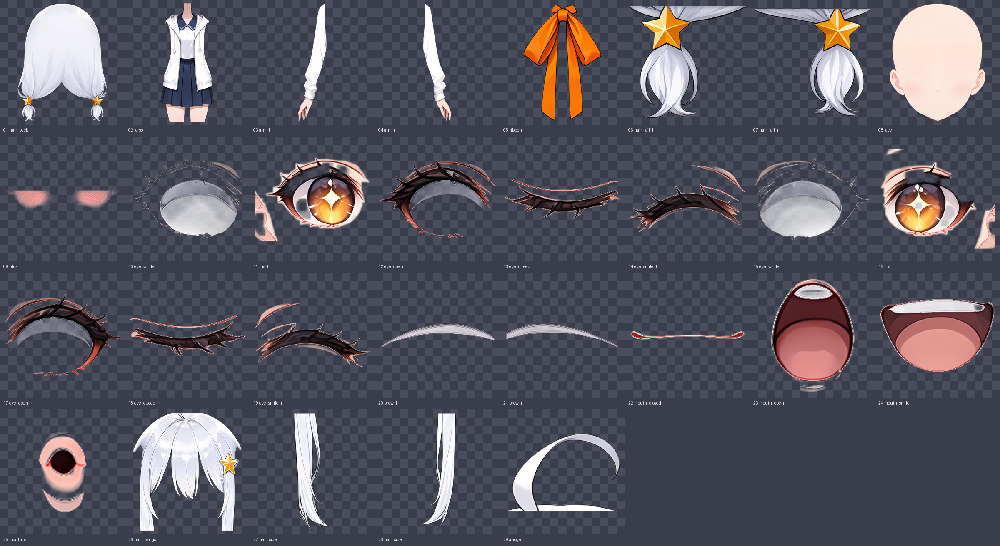

# コハク — AI 生成の 2D VTuber モデル (試作・評価用)

ブラウザで動く 2D アバターです。29 パーツに分かれた立ち絵を WebGL で変形させ、顔の向き・まばたき・口・
髪揺れ・表情 6 種を動かします。インストール不要、ページを開くだけで動きます。

**このキャラクターの絵はすべて AI で生成しています。** 手描きではありません。

## 使い方

- ビューア: `viewer/index.html` (GitHub Pages ならリポジトリの公開 URL を開く)
- マウスで顔と視線が追従。数字キー `1`〜`6` で表情、`H` で操作パネル
- 「カメラ開始」で Web カメラの顔追従、「マイク開始」で口パク
- OBS のブラウザソースには URL の末尾に `?obs=1` を付ける (背景透過。`&mic=1` `&cam=1` も可)

## 動作確認の状況

マウス追従・表情・髪揺れ・透過表示はブラウザで確認済みです。
**Web カメラ追従、マイク口パク、OBS 実機での表示は未確認です。** 動かなかったら Issue で教えてください。

## 利用条件

- 個人が試す・評価する目的で、無料で使えます。
- **収益のある配信や動画、販売物など、商用の利用はできません。** 理由は下の「作り方とライセンス」を見てください。
- モデルの画像 (`model/` 以下) の再配布・販売はしないでください。
- ビューアのコード (`viewer/` 以下) は MIT License です。

## 作り方とライセンス

1 枚の立ち絵を画像生成モデルで描き、その同じ 1 枚を画像編集モデルに参照させて「髪を消す」「目を閉じる」
などと編集し、差分からパーツを切り出しています。

| 用途 | モデル | ライセンス上の扱い |
| --- | --- | --- |
| 立ち絵の生成 | Anima / Hassaku (Anima) — CircleStone Labs | モデルは非商用ライセンス。生成画像の利用は制限なし |
| パーツ・表情の編集 | Qwen-Image-2.1 — Alibaba | Qwen Research License (研究・評価目的のみ)。Built with Qwen |
| 拡大 | Real-ESRGAN (anime 6B) | BSD 3-Clause |
| 顔追従 | MediaPipe Face Landmarker (CDN から読み込み) | Apache 2.0 |

パーツの編集に使った Qwen-Image-2.1 が研究・評価目的に限られているため、このモデルも商用利用不可としています。
